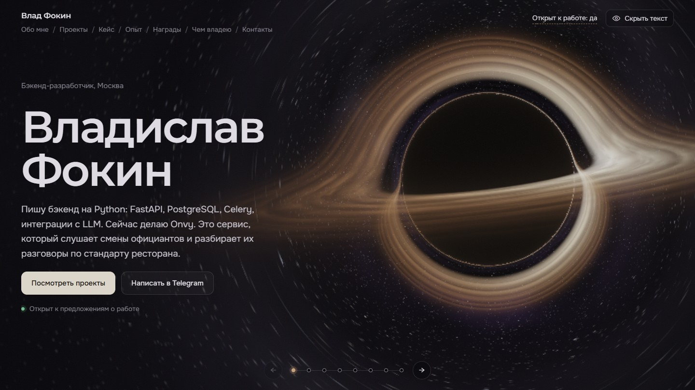

# fokin-portfolio

Мой сайт-портфолио. Одна страница без сборки и без зависимостей: текст о работе и космос на фоне, который считается прямо в браузере на WebGL.



## Как устроен фон

Весь космос рисует один `<canvas>` и один фрагментный шейдер. В нём восемь сцен, по одной на раздел:

| Раздел | Что на фоне |
| --- | --- |
| Главная | чёрная дыра |
| Обо мне | спиральная галактика |
| Проекты | двойная чёрная дыра |
| Кейс | квазар |
| Опыт | пульсар |
| Награды | остаток сверхновой |
| Чем владею | туманность |
| Контакты | горизонт событий |

Чёрные дыры трассируются лучами: для каждого пикселя фотон идёт через пространство Шварцшильда, до 190 шагов на луч. Диск изгибается над дырой и под ней сам, из-за искривления лучей.

При смене раздела камера отлетает от объекта, прыгает через гиперпространство и прилетает к следующему. Текст в это время гаснет и появляется уже на месте.

Кадр собирается в два прохода. Сначала сцена рисуется в текстуру, потом поверх идут волны от кликов, линза под курсором и хроматическая аберрация.

Разрешение подстраивается под частоту кадров. Если устройство всё равно не тянет, сайт сам предлагает лёгкую версию. Без WebGL2 остаётся статичный фон, а с `prefers-reduced-motion` время в сцене течёт в несколько раз медленнее.

## Управление

- Потянуть мышью или пальцем: облететь объект.
- Зажать: подлететь ближе и ускорить время.
- Кликнуть: пустить гравитационную волну.
- Колесо, стрелки ← →, PageUp и PageDown, Home и End: перейти между разделами. На телефоне для этого свайп по тексту.
- Кнопка «Скрыть текст» убирает всё, кроме космоса.

## Запуск

Можно просто открыть `index.html` в браузере. Или поднять любой статический сервер:

```bash
python -m http.server 3430
```

и зайти на `http://localhost:3430`. Шрифты грузятся с Google Fonts, всё остальное лежит в репозитории.

## Что где лежит

- `index.html` — вся разметка и тексты.
- `assets/js/space-frag.js` — шейдеры: сцены и постобработка.
- `assets/js/space.js` — рендер, камера, маршрут между сценами, подстройка разрешения.
- `assets/js/interact.js` — мышь и тач: орбита, приближение, волны.
- `assets/js/main.js` — разделы, навигация, вкладки проектов.
- `assets/css/` — стили.
